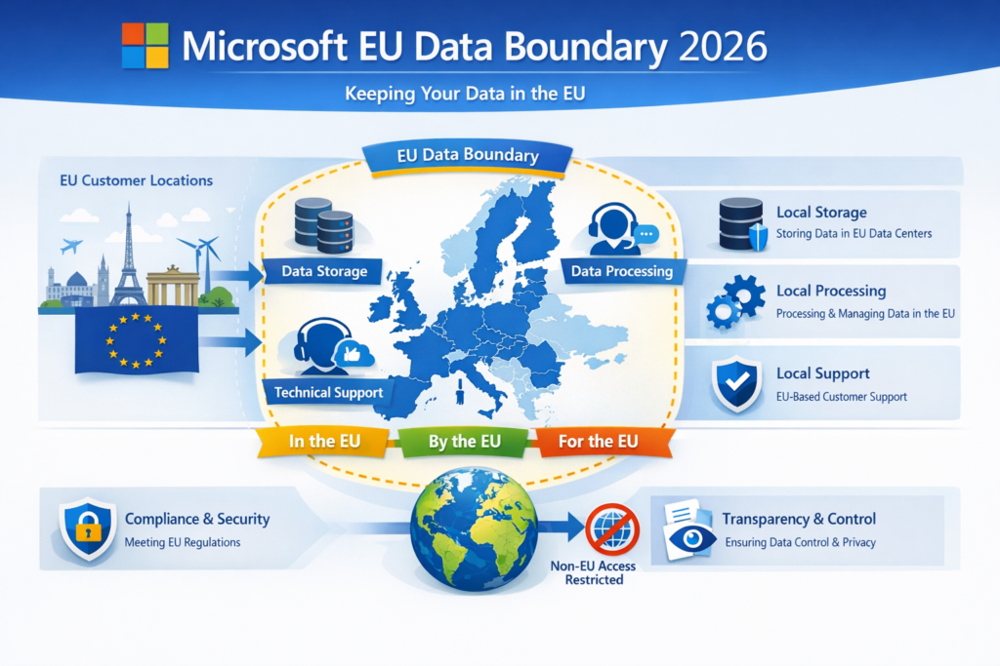
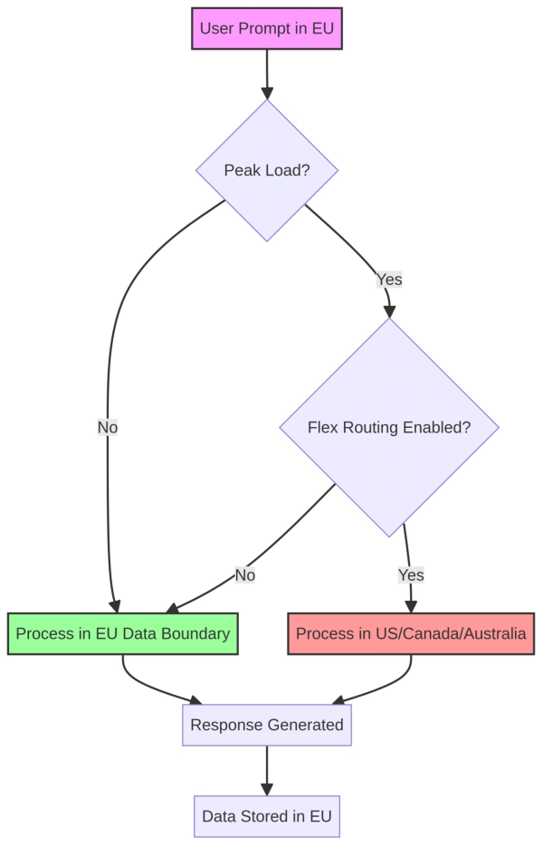
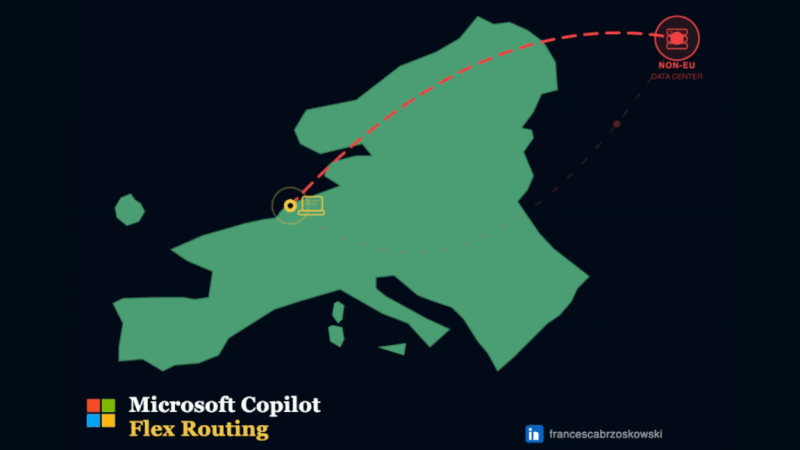
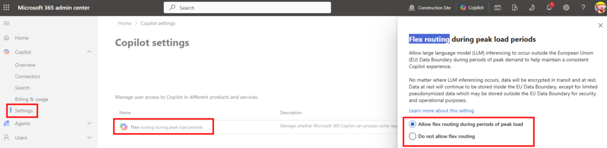
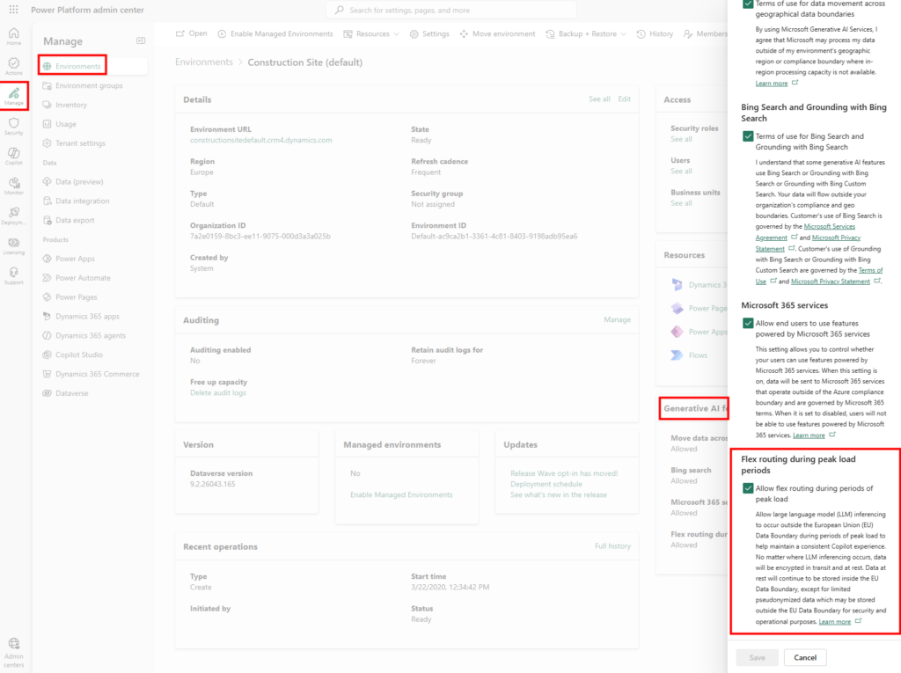
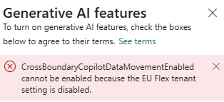
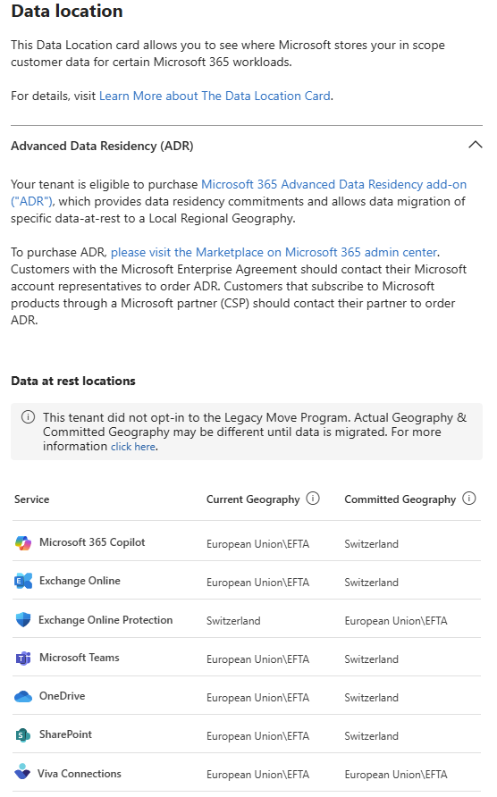

# Microsoft Flex routing – Jean-Loup & Azure

You have heard about the EU Data Boundary here and there, you vaguely know that Microsoft spent years building it as a sovereignty argument for its European customers… and then, silently, a default setting flipped on April 17, 2026. Welcome to **Flex Routing**: your Copilot prompt can now leave the EU Data Boundary during peak loads, without anyone knowing.

This article breaks down what really changes, for whom, and how to decide, with the particular case of ADR tenants who paid for strict local sovereignty.

## Table of Contents

- [1. What exactly is Flex Routing?](#FAQ-1)
- [2. The timeline and the tricky default](#FAQ-2)
- [3. What data actually leaves the EU?](#FAQ-3)
- [4. The compliance issue: GDPR, NIS2, DORA](#FAQ-4)
- [5. Step-by-step: disable in the Microsoft 365 Admin Center](#FAQ-5)
- [6. The Power Platform trap: a second switch](#FAQ-6)
- [7. The ADR paradox: you paid for local sovereignty, so?](#FAQ-7)

### 1. What exactly is Flex Routing?

As a reminder, until now Microsoft had committed to keeping the processing of Copilot EU and EFTA customer data **within the EU Data Boundary**. Storage *at rest*, processing *in transit*, model inference: everything was supposed to remain in European datacenters.

[Copilot: Understanding Microsoft AI in 2026 | InfoNovice.fr](https://www.infonovice.fr/copilot-comprendre-lia-de-microsoft-en-2026/)

Flex Routing changes that. Concretely, it is a **geographic load balancing** mechanism: during demand peaks, the *inferencing* step (the moment when the model processes your prompt to produce a response) can be routed to datacenters outside the EU. Microsoft names three destinations.

> If flex routing is enabled, LLM inferencing may occur in the United States, Canada, or Australia during times of peak demand.
> 
> Source: [Flex routing (EU and EFTA) — Microsoft Learn](https://learn.microsoft.com/en-us/microsoft-365/copilot/copilot-flex-routing)

[Microsoft365-Copilot-Flex-Routing Explained | InvestGlass](https://www.investglass.com/microsoft-365-copilot-flex-routing/)

The idea from Microsoft’s side is to preserve the user experience when European GPUs saturate. When the Azure OpenAI engine in the EU is saturated, rather than timing out, Copilot will knock on the doors of US, Canadian, or Australian datacenters. This is defensible from an engineering perspective. It is less defensible from a sovereignty perspective, especially on opt-out.

### 2. The timeline and the tricky default

The official timeline, as documented by Microsoft:

- **Tenants created after March 25, 2026**: Flex Routing enabled by default, from tenant provisioning.
- **Tenants existing before March 25, 2026**: Microsoft refers to the Message Center to know the default setting applied to your tenant.

In practice, the generalized rollout for existing tenants happened **on April 17, 2026**, via messages `MC1269219` and `MC1269223` in the M365 Message Center. Several analyses by European compliance firms converge on this date.

> On 17 April 2026, Microsoft enabled flex routing for all Microsoft 365 Copilot tenants in the EU and EFTA. Most organisations did not notice.
> 
> Source: [LinkedIn](https://www.linkedin.com/posts/anna-august-phd-102a76a6_microsoftcopilot-eudataboundary-flexrouting-activity-7452346751098773504-o_Ug)

**Warning:** according to Microsoft and field feedback, a change to the Flex Routing setting can take **up to a week** to propagate. If you decide to disable it, do not assume it is immediate: then verify that the setting is properly applied on the tenant side.

The classic trap: this change is **opt-out**, not opt-in. Microsoft made a material change to the processing location, by default, without explicit admin consent. This is the core of the compliance debate detailed in section 4.

### 3. What data actually leaves the EU?

This is where precision is needed, because shortcuts like “your data goes to the US” are both true and false. Microsoft makes a clear distinction between storage and processing:

> No matter where LLM inferencing occurs, data will be encrypted in transit and at rest. Data at rest will continue to be stored inside the EU Data Boundary, except for limited pseudonymized data which may be stored outside the EU Data Boundary for security and operational purposes.
> 
> Source: [Microsoft Learn](https://learn.microsoft.com/en-us/microsoft-365/copilot/copilot-flex-routing)

Let’s break down concretely what happens during a Copilot call routed in flex:

1. **The prompt and its context are assembled in the EU**: your question, plus the grounding (emails, SharePoint/OneDrive files, Graph metadata) that Copilot will inject to answer.
2. **The package is sent encrypted to a datacenter outside the EU** (US, Canada, or Australia depending on available capacity).
3. **Inference takes place outside the EU**: the model processes the prompt, context, and produces the response.
4. **The response returns encrypted to the EU**: it is delivered to the user, and the original data remains stored in the EU.
5. **Pseudonymized data may remain stored outside the EU**, for operational and security purposes (system logs, telemetry).

The keyword is **pseudonymization** in the sense of [GDPR Article 4 (5)](https://gdpr-info.eu/art-4-gdpr/): the data is no longer directly attributable to a person without additional information, but it remains personal data. Microsoft applies encryption, masking, tokenization, and data blurring on these logs, but the re-identification authority remains theoretically possible.

**My field feedback:** many European DPOs and CISOs read “data at rest stays in the EU” and conclude everything is fine. The hard point is the moment of inference — it is *there* that your prompt, and thus potentially your documents and emails, are exposed to the model in a datacenter outside the EU. This point must be traced in your transfer analyses.

### 4. The compliance issue: GDPR, NIS2, DORA

Concretely, what does this mean for compliance? Three frameworks overlap and each has its interpretation of the subject.

#### GDPR: a transfer to a third country, by default

Processing personal data in a third country is a **transfer** under Articles 44 and following of the GDPR. A legal basis is required:

- **United States**: adequacy decision via the EU-U.S. Data Privacy Framework (Article 45 GDPR), provided Microsoft is listed and the transfer falls within the scope of the DPF.
- **Canada and Australia**: Standard Contractual Clauses (Article 46(2)(c) GDPR), accompanied by a Transfer Impact Assessment (TIA).

And even when a transfer mechanism applies, it does not exempt proper documentation. If your DPIA mentions intra-EU processing and inference now happens in the US, your DPIA is **outdated**. If your privacy policy mentions European processing, it is **inaccurate**. If your **record of processing activities** (RoPA, Article 30 GDPR) does not reflect this transfer, it is a violation.

#### NIS2: the IT supply chain

For essential and important entities under NIS2, the IT supply chain risk is explicitly in scope. A material change in processing location at a critical supplier, by default, without review, is exactly the kind of scenario supplier due diligence obligations are meant to detect.

#### DORA: financial operational resilience

For financial entities, DORA imposes active due diligence on critical ICT providers. Microsoft 365 Copilot typically falls into this category: a change in processing location must be traced, evaluated, and documented in the provider register.

**Warning:** none of these points require a data breach to become a regulatory issue. An audit, a CNIL inspection, or a simple complaint is enough. The Microsoft Message Center is no longer just an IT channel: it has become a compliance channel that someone in the organization must monitor.

### 5. Step-by-step: disable in the Microsoft 365 Admin Center

If you decide to disable, here is the exact path. You will need the **AI Administrator** role (or Global Administrator).

1. Sign in to the [Microsoft 365 Admin Center](https://admin.microsoft.com).
2. In the side navigation, open **Copilot**, then **Settings**.
3. Click **View all** to show advanced options.
4. Find the entry **Flex routing during peak load periods**.
5. Select **Do not allow flex routing**.
6. Confirm.

Technical result: all LLM inferencing remains forced inside the EU Data Boundary, including during peaks. The assumed trade-off is a **potential degradation of Copilot performance** or availability during regional overload periods. For most office uses, this is acceptable. For demanding real-time uses, it deserves testing.

### 6. The Power Platform trap: a second switch

The trap many admins miss: this first switch may not cover all your needs. The Microsoft 365 Admin Center setting covers Microsoft 365 Copilot and Copilot Chat. For Copilots in Dynamics 365, Power Platform, and Copilot Studio, there is a **second setting** in the Power Platform Admin Center, managed at the environment level.

The dependency is hierarchical:

- If Flex Routing is disabled in the M365 Admin Center, the Power Platform setting is **locked off**.
- If Flex Routing is enabled in the M365 Admin Center, the Power Platform setting is **configurable**.

To disable it on the Power Platform side:

1. Sign in to the [Power Platform Admin Center](https://admin.powerplatform.microsoft.com).
2. In the navigation pane, go to **Manage > Environments**.
3. Select the relevant environment.
4. In the **Generative AI features** card, click **Edit**.
5. Uncheck **Allow flex routing during periods of peak load**.
6. Confirm.

This message appears if you try to modify it here while it has already been disabled in the Microsoft 365 Admin Center:

**My field feedback:** on a tenant with both Microsoft 365 Copilot and Copilot Studio agents, I saw teams conscientiously disable the M365 setting… forgetting that Copilot Studio agents in Power Platform environments remained on the inherited default. If you operate on both sides, check both switches, environment by environment.

### 7. The ADR paradox: you paid for local sovereignty, so?

A quick product reminder to situate: **Advanced Data Residency (ADR)** is an M365 add-on that provides a durable commitment to data residency in a *Local Region Geography*: France, Germany, Norway, Switzerland, Sweden, etc. It is the add-on many European companies subscribed to go beyond the basic “EU Data Boundary” promise and guarantee their data stays in *their* country.

Concretely, what does this mean with Flex Routing?

Microsoft’s documentation on Flex Routing explicitly excludes **Multi-Geo** tenants from the EU Data Boundary scope (so the setting does not appear in the M365 Admin Center for them):

> Customers who have purchased or used [multi-geo capabilities](https://learn.microsoft.com/fr-fr/microsoft-365/enterprise/microsoft-365-multi-geo) are not within the scope of the EU data boundary for Microsoft 365, even if their tenant is listed as being in an EU or EFTA country or region. The flexible routing setting is not available in the Microsoft 365 admin center for customers who have purchased or used multi-geo capabilities. Purchasing multi-geo capabilities does not impact the availability of the flexible routing setting in the Power Platform admin center.
> 
> Source: [Microsoft Learn](https://learn.microsoft.com/en-us/microsoft-365/copilot/copilot-flex-routing#eligibility)

On the other hand, **it does not mention any exclusion for ADR tenants**. The logical conclusion: if you are an ADR tenant located in an EU/EFTA country, you are within the EU Data Boundary scope, and therefore within the Flex Routing scope. The setting is displayed, can be enabled, and is subject to the same opt-out default as other tenants.

**My field feedback:** this is the real paradox. The customers who paid for ADR are precisely those who made a *stricter* sovereignty commitment than average. That their Copilot inference might by default go to the US or Canada, without documented review, is exactly what they wanted to avoid by signing the ADR. These tenants must check the setting as a priority and document the decision in their RoPA and DPIA.

The hard point is not that Microsoft did something illegal: the Standard Contractual Clauses and the DPF can technically cover the transfer. The hard point is that **the commercial promise of ADR (strict local residency) and the default behavior of Flex Routing (possible inference outside the EU) are not aligned**.

## Conclusion

Here is what Flex Routing changes for your Microsoft 365 Copilot tenant. The issue is not dramatic in itself, legal transfer mechanisms exist, encryption holds, and at-rest storage remains in the EU. But the opt-out default, on a topic where Microsoft had built a strong sovereignty promise, clearly deserved a conscious decision by each tenant admin.

The main pitfalls to remember:

1. **The opt-out default**: your tenant is probably already on active flex routing. Check before concluding anything.
2. **The propagation delay**: up to one week after changing the setting. Anticipate if an audit deadline is approaching.
3. **The second Power Platform switch**: disabling on the M365 side is not enough if you operate Copilot Studio agents or Copilot Dynamics 365.
4. **The ADR paradox**: tenants who paid for strict local residency are the first to have to resolve this issue, under penalty of inconsistency between the commercial commitment and the default behavior.

Go check your tenant today. It takes five minutes in the admin center, and it’s exactly the kind of point you don’t want to discover on the day of a CNIL audit or an internal review on data sovereignty.